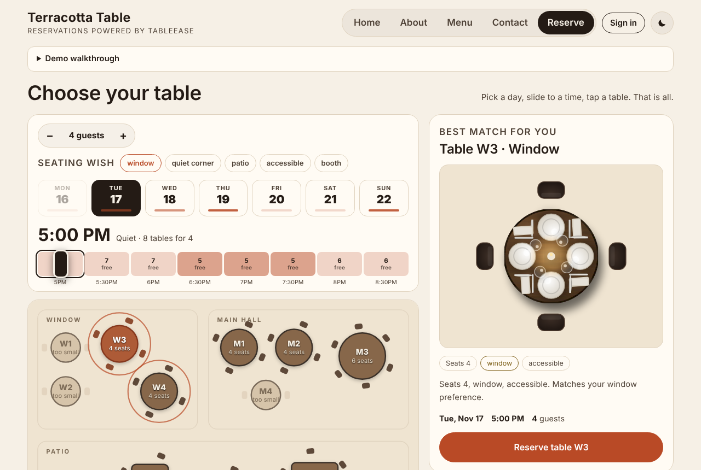

# TableEase

Restaurant reservation and management web application. Guests browse the menu and book a table on a live floor plan; staff run service from a dashboard. Academic full-stack project (course: Project, Algonquin College).



## Status

This project is in progress. The backend API is built and tested. The user interface exists as an interactive prototype in plain JavaScript with sample data; it is being rebuilt in React and will then be connected to the API.

| Part | State |
| --- | --- |
| Django REST API (auth, availability, reservations, waitlist, tables, customers, insights) | Done, 25 automated tests |
| Interactive prototype (all guest and staff screens, light and dark mode) | Done, uses sample data, not connected to the API |
| React frontend | In progress |
| Integration of React with the API | Planned, early December |
| Email notifications, password reset email | Not built |

## Features

**Guests and customers**
- Browse the restaurant information and the menu (four categories, dietary tags).
- Choose party size, seating wishes, day and time; see how busy each time is; pick a table on a floor plan.
- Join a waitlist when a time is full; accept a 15 minute hold when a table frees up.
- Sign up, sign in, manage a booking with a reservation number and email, cancel.

**Staff**
- Live floor, reservations list (seat, cancel, walk-in and phone bookings), customers, tables, opening hours and closing dates, daily insights.
- Role-based access: new accounts are always customers; staff endpoints return 401 for visitors and 403 for customers.

## Tech stack

- **Backend:** Python, Django 5, Django REST Framework, token authentication, django-cors-headers
- **Database:** SQLite in development, PostgreSQL when `POSTGRES_DB` is set
- **Frontend (planned):** React
- **Prototype:** vanilla JavaScript, CSS custom properties, no build tools required

## Repository structure

```
backend/      Django project and the reservations app (models, services, API, tests)
prototype/    Interactive front-end prototype (src/ modules, built single-file demo)
docs/         Iteration I and II documents, screenshots
```

## Getting started

### Backend

```bash
cd backend
python3 -m venv .venv
source .venv/bin/activate          # Windows: .venv\Scripts\activate
pip install -r requirements.txt
python manage.py makemigrations reservations
python manage.py migrate
python manage.py seed              # 12 tables + demo accounts: staff / staffpass123, guest / guestpass123
python manage.py runserver         # API at http://127.0.0.1:8000/api/
python manage.py test              # runs the 25 automated tests
```

The demo accounts are for local development only. Settings read `DJANGO_SECRET_KEY` and `DJANGO_DEBUG` from the environment; set them before deploying anywhere.

### Prototype

Open `prototype/tableease-demo.html` in a browser. Sign in with `staff` / `staffpass123` to see the staff area, or `guest` / `guestpass123` for a customer account. Data is sample data and resets on reload.

To rebuild the single file from the modules in `prototype/src/`, run `bash prototype/src/build.sh` (Node.js is used for a syntax check).

## API overview

All endpoints are under `/api/`. Send the token as `Authorization: Token <key>`.

| Method and path | Who | What |
| --- | --- | --- |
| `POST auth/register/`, `auth/login/`, `auth/logout/`, `GET auth/me/` | public / signed in | Token authentication |
| `GET availability/?date=&party=` | public | Crowding level for every time slot |
| `GET availability/?date=&party=&time=19:00` | public | Free tables that fit the party |
| `POST reservations/` | public | Create a booking (409 if the table was just taken) |
| `GET reservations/` | customer | Own bookings |
| `POST reservations/{id}/cancel/` | owner or staff | Cancel; first waiting party gets a 15 minute hold |
| `GET reservations/lookup/?reference=&email=` | guest | Look up a booking |
| `POST waitlist/` | public | Join the waitlist for a full time |
| `GET reservations/all/`, `POST reservations/staff/`, `POST reservations/{id}/status/` | staff | Reservation management |
| `tables/`, `blocked-tables/` | read public, write staff | Table management |
| `GET customers/`, `GET staff/insights/` | staff | Customers and daily insights |

## Business rules

Open Tuesday to Sunday, first seating 5:00 PM, last seating 8:30 PM, 90 minute stays, parties of 1 to 8, bookings up to 60 days ahead. Two bookings overlap when `existing.start < new.end and existing.end > new.start`. The table row is locked inside a database transaction, so simultaneous requests cannot double-book. All rules live in `backend/reservations/services.py`.

## Roadmap

| When | Milestone |
| --- | --- |
| Mid November | React frontend: layout, account pages, information and menu pages |
| Late November | Reservation flow and available times in React |
| Early December | Staff screens, integration with the API and database |
| Early to mid December | Responsive, usability, authentication and double-booking tests |
| Mid to late December | Documentation, presentation, final submission |

## Documentation

- Iteration I: use case scenarios, wireframes, information architecture; flow diagrams, mockups, technical specification (`docs/iteration-1/`)
- Iteration II: use case status, information architecture as built, screens (`docs/iteration-2/`)

## Known limitations

Menu items, prices, the restaurant story, address and phone are placeholders. Opening hours are set in backend settings; the editor exists only in the prototype.

## Author

Tina Asadi. Course: Project, Professor Wei Gong.
